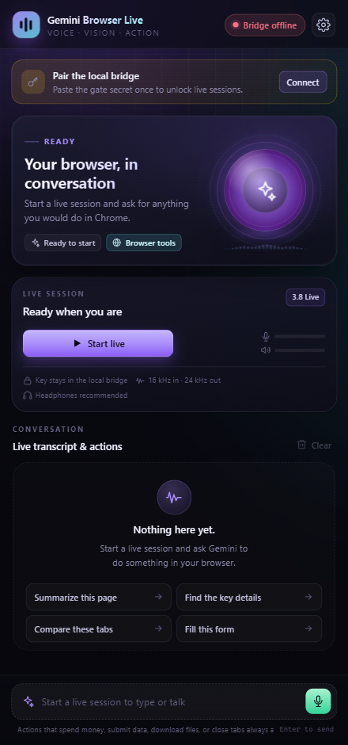

# Gemini Browser Live

**Talk to your browser.** A real-time Gemini Live voice agent that lives in Chrome's side panel, sees the page you are on, and operates it through 52 typed tools — with a code-enforced approval gate for anything consequential.



> Screenshot captured from the automated Chrome E2E run. The bridge is intentionally offline in that run, so the header shows **Bridge offline**.

---

## What it is

Gemini Browser Live is a Chrome Manifest V3 extension plus a small loopback bridge.

- **You speak.** The microphone is captured at 16 kHz, streamed as raw PCM over a Gemini Live WebSocket.
- **Gemini answers in native audio** at 24 kHz, with barge-in that flushes queued playback immediately.
- **The agent acts** through a typed tool catalog: read the page, find elements, click, type, navigate, extract tables, compare page states, download a document it has verified, and more.
- **Nothing consequential happens silently.** Spending money, submitting data, downloading files, closing tabs, and signing in always require an explicit click in the approval sheet.
- **The model is given evidence, not assumptions.** Every action returns evidence; mutating tools are re-observed and verified before the model is told they worked.

The permanent Gemini API key never enters the extension. Chrome only ever holds a short-lived, single-use ephemeral token minted by the local bridge.

---

## Capabilities

| Area                        | What is implemented                                                                                                                                                |
| --------------------------- | ------------------------------------------------------------------------------------------------------------------------------------------------------------------ |
| Voice                       | 16 kHz PCM capture, 24 kHz PCM playback, AudioWorklet ring buffer, instant barge-in, mute, output volume, local VAD silence trimming                               |
| Session                     | Ephemeral token minting, proactive rotation ~60 s before expiry, reconnect with `sessionResumption` handle, exponential backoff, clean cancellation                |
| Browser control             | 52 tools across tabs, navigation, semantic DOM reading, interaction, forms, screenshots, vision-assisted clicking, page comparison, bookmarks, history, downloads  |
| Grounding                   | Accessibility/role-aware element registry with stable handles, fingerprints, bounding boxes, visible-text snapshots, page-state hashing                            |
| Safety                      | Hard blocks on dangerous URL schemes and `chrome://` surfaces, risk classification, approval sheet, 120 s approval timeout, per-tool timeouts                      |
| Verification                | Post-action observation, navigation settling, download completion checks, "changed" evidence returned to the model                                                 |
| Prompt-injection resistance | Page text is framed as untrusted data, system instruction forbids following page instructions, approval consent cannot be granted by page content                  |
| UI                          | Premium dark side panel: onboarding, live session card, transcript with actions, composer, settings (connection, voice, agent, access, privacy), toasts, approvals |
| Access                      | Optional `downloads` / `bookmarks` / `history` permissions requested at the point of use, with runtime checks                                                      |
| Privacy                     | Transcript retention is opt-in (session-only by default), URL query secrets stripped before reaching the model, no telemetry                                       |

---

## Architecture

```
┌────────────────────────────── Chrome ──────────────────────────────┐
│                                                                    │
│  Side panel (React)                                                │
│   ├── controller.ts ── owns every side effect                      │
│   ├── LiveSessionManager ── token → connect → setup → reconnect     │
│   ├── AgentOrchestrator ── validate → approve → execute → verify    │
│   └── ToolExecutor ── 52 browser capabilities                      │
│         │ chrome.scripting / chrome.tabs / chrome.downloads        │
│         ▼                                                          │
│  Content script (on demand) ── DOM registry, snapshots, actions     │
│                                                                    │
│  Background service worker ── commands, panel opening, messaging    │
└───────────────┬────────────────────────────────────────────────────┘
                │ HTTPS (ephemeral token + gate secret)
                ▼
┌──────────────────────── Local bridge (Node) ───────────────────────┐
│  POST /api/token   ── validates gate secret + extension origin     │
│  GET  /api/health  ── liveness without secrets                     │
│  GET  /api/config  ── public limits, never the API key             │
│  Holds GEMINI_API_KEY in process memory only                       │
└───────────────┬────────────────────────────────────────────────────┘
                │ WSS + ephemeral access_token
                ▼
     Gemini Live API (gemini-3.8-live)
```

Audio never passes through the bridge. The bridge only mints tokens and reports configuration; the side panel connects to Google directly.

More detail: [docs/ARCHITECTURE.md](docs/ARCHITECTURE.md).

---

## Requirements

| Requirement       | Version                                                                |
| ----------------- | ---------------------------------------------------------------------- |
| Chrome / Chromium | 116 or newer (side panel API)                                          |
| Node.js           | 20.19 or newer (24.x tested)                                           |
| npm               | 10 or newer                                                            |
| Gemini API key    | A key with Live API access                                             |
| OS                | Windows 10/11 tested; macOS/Linux should work with manual `.env` setup |

A microphone and headphones are recommended. Headphones prevent the model from hearing its own voice.

---

## Quick start (Windows)

```powershell
# 1. Install dependencies
npm install

# 2. Create the bridge configuration (prompts for the API key without echoing it)
powershell -ExecutionPolicy Bypass -File scripts/setup-windows.ps1

# 3. Build the extension and bridge
npm run build

# 4. Start the bridge and leave the window open
npm run bridge
```

Then:

1. Open `chrome://extensions`.
2. Enable **Developer mode**.
3. Choose **Load unpacked** and select `release/chrome-extension`.
4. Click the extension icon (or press `Alt+Shift+S`) to open the side panel.
5. Click **Connect** on the pairing banner (or open **Settings → Connection**), paste the gate secret printed by the setup script, press **Test connection**, then **Save settings**.
6. Press **Start live** and allow microphone access.

The setup script derives the extension ID from the manifest `key`, generates a 43-character gate secret, writes `apps/local-bridge/.env` as UTF-8 without a BOM, and best-effort restricts the file ACL to your user.

### macOS / Linux

```bash
npm install
cp apps/local-bridge/.env.example apps/local-bridge/.env
# edit .env: set GEMINI_API_KEY and a 32+ character LOCAL_GATE_SECRET
# set ALLOWED_EXTENSION_IDS to the ID Chrome shows on chrome://extensions
npm run build
npm run bridge
```

The manifest ships a stable `key`, so the extension ID is `hhbdkheccnmpbdadhhppbemcjkaimlob` when loaded unpacked from this manifest. If you change the manifest, update the allowlist.

Full instructions and troubleshooting: [docs/INSTALLATION.md](docs/INSTALLATION.md).

---

## Using it

Try:

- “What does this page say? Summarise the main points.”
- “Find the pricing table and read it out.”
- “Open the docs in a new tab and compare the two versions.”
- “Fill in the search box with ‘quarterly report’ and submit it.” _(approval required)_
- “Download the official PDF from this page.” _(approval + verification)_
- “Which tabs do I have open? Close the ones about the old project.” _(approval required)_

### Keyboard shortcuts

| Shortcut      | Action                       |
| ------------- | ---------------------------- |
| `Alt+Shift+S` | Start a live session         |
| `Alt+Shift+X` | End the session              |
| `Alt+Shift+M` | Mute / unmute the microphone |
| `Alt+Shift+O` | Open settings                |

### Approval gates

These actions always ask, even when _Confirm risky actions_ is turned off:

- Spending money, checkout, transfers, purchases
- Submitting forms, sending messages, posting, publishing
- Deleting, deactivating, unsubscribing
- Signing in / registering / accepting terms
- Downloads and installs
- Closing tabs
- Any coordinate-based visual click

The approval sheet shows the exact tool, the target, and a human-readable summary. Page content can influence _what_ the agent proposes; it can never grant consent. Approvals expire after 120 seconds.

---

## Security at a glance

| Control           | Implementation                                                                                  |
| ----------------- | ----------------------------------------------------------------------------------------------- |
| API key isolation | Key lives only in the bridge process; never sent to Chrome, never logged                        |
| Ephemeral tokens  | Single-use, ~30 min TTL, constrained to one model                                               |
| Gate secret       | 32+ random characters, pasted once, stored in `chrome.storage.local`, compared in constant time |
| Origin allowlist  | Bridge validates `Origin` against `chrome-extension://<id>` and an explicit extra-origin list   |
| Host allowlist    | Requests must target loopback (`127.0.0.1` / `localhost`)                                       |
| Rate limiting     | Sliding-window limiter on token minting                                                         |
| Body limits       | 8 KB request cap, 25 s request timeout                                                          |
| CSP               | Extension pages only load `self`, Google, and loopback bridge origins                           |
| Dangerous schemes | `javascript:`, `data:`, `file:`, `chrome:`, `blob:` and friends are hard-blocked                |
| Prompt injection  | Page text framed as data; system instruction forbids obeying it; consent is code-enforced       |
| Secret leakage    | URL userinfo and sensitive query parameters stripped from tool output                           |

Read the full threat model: [docs/SECURITY.md](docs/SECURITY.md).

---

## Repository layout

```
apps/
  chrome-extension/     Manifest V3 extension
    src/
      sidepanel/        React UI, controller, settings, approvals
      live/             Live client, setup, session manager, bridge client
      agent/            Orchestrator: approval, verification, cancellation
      tools/            52-tool executor, page bridge, snapshots
      content/          Content script, DOM registry, reader, interactions
      audio/            Capture, playback, resampler, AudioWorklets
  local-bridge/         Dependency-light Node token broker
packages/
  shared/               Tool catalog, schemas, safety policy, protocol types
scripts/                Build, release, setup, probes, smoke test, icons
tests/
  unit/                 211 Vitest tests
  e2e/                  18 Playwright tests against real Chrome
.github/
  workflows/ci.yml      Checks, browser E2E, and release artifact jobs
docs/                   Architecture, security, permissions, research, evidence
release/                Built extension + deterministic ZIP (gitignored)
```

---

## Commands

| Command                   | Purpose                                                                |
| ------------------------- | ---------------------------------------------------------------------- |
| `npm run build`           | Production build of extension + bridge                                 |
| `npm run build:extension` | Extension only                                                         |
| `npm run bridge`          | Start the built bridge                                                 |
| `npm run dev:bridge`      | Start the bridge with watch mode                                       |
| `npm test`                | Run 211 unit tests                                                     |
| `npm run test:e2e`        | Run 18 Playwright tests in Chrome                                      |
| `npm run test:all`        | Typecheck + lint + unit + E2E                                          |
| `npm run typecheck`       | TypeScript across all workspaces                                       |
| `npm run lint`            | ESLint 10 flat config                                                  |
| `npm run format`          | Prettier write                                                         |
| `npm run release`         | Build, validate manifest references, write deterministic ZIP + SHA-256 |
| `npm run docs:api`        | Generate TypeDoc API reference into `docs/api/`                        |     | `npm run smoke:live` | Real Live API round trip through the built bridge |

---

## Evidence and status

- [docs/TEST_REPORT.md](docs/TEST_REPORT.md) — commands, dates, results, and what is _not_ covered.
- [.github/workflows/ci.yml](.github/workflows/ci.yml) — typecheck/lint/format/unit, headed-Chromium E2E under Xvfb, and release artifact jobs. Committed but not yet executed on GitHub (no remote configured).
- [docs/IMPLEMENTATION_STATUS.md](docs/IMPLEMENTATION_STATUS.md) - requirement-by-requirement PASS / PARTIAL / NOT TESTED matrix.
- [CHANGELOG.md](CHANGELOG.md) - development cycle history.
- [docs/TECHNICAL_RESEARCH.md](docs/TECHNICAL_RESEARCH.md) — Live API protocol findings, including the dead ends.
- [docs/PERMISSIONS.md](docs/PERMISSIONS.md) — every Chrome permission and why it exists.

### Known limitations

- Automated E2E does not exercise a real microphone or a real Google session; that path is covered by unit tests, a protocol smoke test, and manual use.
- `gemini-3.8-live-extended-thinking` cannot call tools in the current API version, so browser control is disabled in that mode.
- Chrome refuses script injection on `chrome://`, the Web Store, and other protected pages; the agent reports this instead of pretending.
- The bridge is a local development component, not a multi-user server. Do not expose it to a network.

---

## Documentation index

| Document                                                       | Contents                                                         |
| -------------------------------------------------------------- | ---------------------------------------------------------------- |
| [docs/INSTALLATION.md](docs/INSTALLATION.md)                   | Setup, loading, pairing, troubleshooting                         |
| [docs/ARCHITECTURE.md](docs/ARCHITECTURE.md)                   | Components, data flow, lifecycle, design decisions               |
| [docs/SECURITY.md](docs/SECURITY.md)                           | Threat model, secret handling, approval model, injection defence |
| [docs/PERMISSIONS.md](docs/PERMISSIONS.md)                     | Chrome permission rationale and user impact                      |
| [docs/TOOL_REFERENCE.md](docs/TOOL_REFERENCE.md)               | All 52 tools, risk level, and evidence returned                  |
| [docs/TECHNICAL_RESEARCH.md](docs/TECHNICAL_RESEARCH.md)       | Protocol probes, model capabilities, rejected approaches         |
| [docs/TEST_REPORT.md](docs/TEST_REPORT.md)                     | Test evidence and coverage gaps                                  |
| [docs/IMPLEMENTATION_STATUS.md](docs/IMPLEMENTATION_STATUS.md) | Acceptance criteria matrix                                       |
